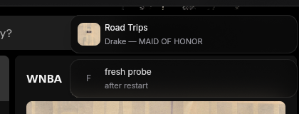
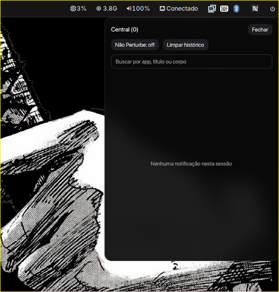

# Nobody

A Wayland notification daemon. It owns `org.freedesktop.Notifications` on the
session bus and renders notifications top-right in a layer-shell window.

Built with [GPUI](https://github.com/zed-industries/zed) and zbus. No GTK.




## Install

```sh
curl -fsSL https://github.com/nuevosik/Nobody/releases/latest/download/install.sh | sh
```

Drops `nobody` in `~/.local/bin`; override with `NOBODY_INSTALL_DIR`. Stop any
daemon already owning the name, then start it from your compositor:

```conf
exec-once = pkill mako; nobody
```

`~/.local/bin` must be on the compositor's `PATH`.

From source: `cargo run --release`. Needs a Wayland session with Layer Shell, a
D-Bus session bus, and the usual GPUI packages (`libwayland`, `libxkbcommon`,
Vulkan).

## Use

```sh
nobody                                        # run the daemon
nobody center open | close | toggle
nobody dismiss all | 42 | app "Spotify"
nobody dnd on | off | toggle | status
nobody list --json | history --json
```

- Click, Escape, Enter or Space dismisses a notification. With an action button
  focused, Enter and Space activate that action instead.
- Keeps 12 notifications, renders the 5 most recent. The center lists the
  session's last 100, searched by application, title or body as you type, and
  is read-only: no actions, no replay. History is in-memory only, so a restart
  starts empty.
- Timeout `-1` is the server default (5s), `0` never expires, critical never
  expires. A `value` hint (int32, 0–100) draws a progress bar.
- `x-dunst-stack-tag` and `x-canonical-private-synchronous` replace the previous
  notification from the same application, keeping its id.
- Each action key/label pair becomes a button; `default` shows as `Open`. On
  Hyprland the `default` action also focuses the app's most recent window. The
  daemon never executes the key as a command — the client decides navigation.
- Effective quiet is manual OR fullscreen, and the fullscreen detector never
  overrides the manual preference.
- Control commands exit `0` when done, `1` on daemon/D-Bus failure, `2` on bad
  syntax, and never start the GUI.
- Spotify notifications carry the current album cover (MPRIS + `curl`), cached
  under `~/.cache/nobody/covers/`.

Browsers reach Nobody through the standard D-Bus interface, so they need
`body` and `actions` advertised — which they are. A Flatpak or Snap browser may
go through the portal instead of the bus.

## Config

`$XDG_CONFIG_HOME/nobody/config` when `XDG_CONFIG_HOME` is absolute, otherwise
`~/.config/nobody/config`. Three keys, `#` comments, last valid value wins,
restart to apply:

```conf
default-timeout=5000
max-visible=5
anchor=top-right
```

## Waybar

Optional, and the installer leaves your Waybar alone. Drop the badge somewhere
and point an image module at `nobody center toggle`:

```sh
install -Dm644 assets/nobody-badge.png "$HOME/.local/share/nobody/nobody-badge.png"
```

```json
"image#nobody": {
    "exec": "printf '%s\\n' \"$HOME/.local/share/nobody/nobody-badge.png\" 'Notification center'",
    "size": 16,
    "interval": 3600,
    "on-click": "\"$HOME/.local/bin/nobody\" center toggle",
    "tooltip": true
}
```

## Development

```sh
./scripts/check.sh                                  # everything CI runs
ln -sf ../../scripts/check.sh .git/hooks/pre-push   # run it before each push
```

Four layers, one rule: `domain <- application <- infrastructure / presentation`,
and the last two never import each other. Details in `docs/architecture.md`.

`PREFERS_REDUCED_MOTION=1` disables animations.

## Release

```sh
./scripts/release.sh 0.1.1
```

Bumps `Cargo.toml`, tags `v0.1.1`, pushes, and waits for the release workflow
to publish `nobody-<triple>.tar.gz` — the asset `install.sh` downloads.
